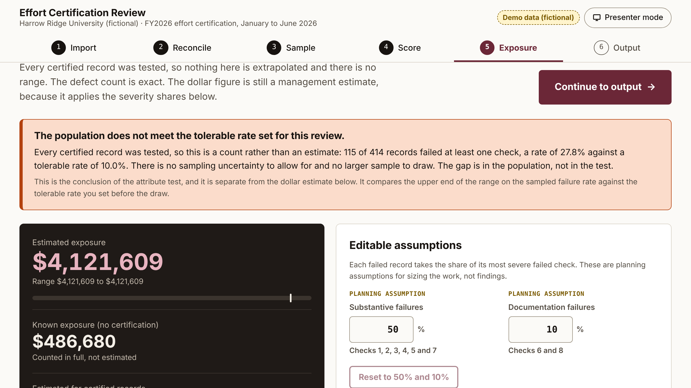

# Effort Certification Review

**Free. Runs in your browser. Your file is never uploaded.**

**Run it:** https://saintilco.com/effort-certification-review.html

For grants teams. Load your effort certification export and the review tests every certified record against eight evidence checks drawn from 2 CFR 200.430(g): population, routing, timing and evidence. It ties the population to your ledger, sizes the dollar exposure, and gives you a decision record (PDF) and a working Excel workbook.

## Try it with the sample file

`samples/sample_effort_certifications_fictional.csv` holds eight made-up people in the tool's import format, including one never certified, one signed late, one self-certified and one with a large variance. It imports with 0 row errors.

`samples/effort-certification-template.csv` is the blank template the page offers for download.

The page's "Load demo dataset" button runs a larger fictional university: 420 people, 414 certified.

## How it is tested

- **Automated tests:** the build record lists 233 automated tests, TypeScript clean.
- **Workbook:** the Excel output was recalculated independently (3,954 formulas, zero errors) and matches the engine to the dollar on the file a browser actually downloads.
- **End to end in a real browser:** verified twice before launch on the demo dataset. Re-run on the live build in Chrome on 11 November 2026: 420 rows read, 0 row errors, 115 of 414 records failed at least one check (27.8%), USD 486,680 known exposure and a USD 4,121,609 headline, the same figures as at launch.
- **The sample file in this repository** was imported into the live build on 11 November 2026 with 0 row errors.

The review documents evidence. It does not test whether the effort occurred, the dollar figure is a management estimate on assumptions you can see and change, and it does not predict an audit outcome.

## What this repository is

A showcase: what the tool does, what it looks like, made-up sample files to try it with, and how it is checked. The tool itself runs on saintilco.com. **No source code, test suites or answer keys are published here.**

Everything in `samples/` is fictional. No client data, real names or real figures appear anywhere in this repository.

## About

Built by [Saintilco Consulting](https://saintilco.com), independent Workday Financials controls reviews. Saintilco Consulting is not affiliated with, sponsored by, or endorsed by Workday, Inc. WORKDAY is a trademark of Workday, Inc. Commercial and systems guidance only, not legal, tax, accounting or audit advice.

Copyright 2026 Saintilco Consulting. All rights reserved. No license is granted to copy, modify or redistribute the tool or this material.
